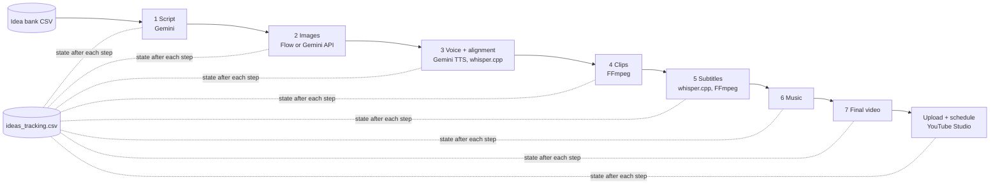

# ai-content-automation-engine

[](https://github.com/JeremyAyza/ai-content-automation-engine/actions/workflows/ci.yml)

Python pipeline that turns an idea into a narrated, subtitled short or long video in seven resumable steps, and schedules it on YouTube.

> Built on top of [AI Content Automation Engine](https://github.com/hans1801/AI-Content-Automation-Engine) by Hans ([video](https://www.youtube.com/watch?v=IM8PfqjpvaM)). I took his April 2026 version and have been reworking it since May 2026 to run my own channels. See [What I changed](#what-i-changed) for what is mine.

Status: personal tool, in daily use. It produced the videos of [@Hackea_Tu_Riqueza](https://www.youtube.com/@Hackea_Tu_Riqueza): 190 videos and about 200 organic subscribers, with Shorts reaching up to ~1.1K views (October 2026). It runs on Windows with an NVIDIA GPU.

## What it does

1. **Script**: Gemini writes an idea (optionally from a CSV bank of base ideas) and a scene-by-scene script with image prompts and narration.
2. **Images**: one image per scene, through Google Flow's web app (default) or the Gemini image API.
3. **Voice**: Gemini TTS in batches, then whisper.cpp plus Gemini align the audio to each scene.
4. **Video**: FFmpeg turns each image and its audio into a clip with a slight zoom and rotation, then joins them.
5. **Subtitles**: whisper.cpp transcribes the result and FFmpeg burns the subtitles in.
6. **Music**: mixes in a random background track from `resources/bg-music/`.
7. **Final**: renames the video after its title and deletes the heavy intermediate files.

Every video is a row in a CSV with its state, so the pipeline can stop at any step and resume later. A separate script uploads finished videos to YouTube Studio and schedules each one in the next free slot.

## What I changed

The seven-step structure, the CSV state, the Pydantic prompt managers, the Gemini tools, whisper.cpp alignment and FFmpeg assembly come from the original project. On top of that:

- **Cheaper images.** The original sent 5 style reference images with every image request to the Gemini API. I first merged them into a single collage (one reference instead of five), then added a second image provider that drives Google Flow's web app through Playwright and my [Flow Image Automator](https://github.com/JeremyAyza/flow-image-automator) extension. Flow is now the default; the API provider is still there (`IMAGE_PROVIDER=api`).
- **Cheaper voice.** Moved TTS to `gemini-2.5-flash-preview-tts`, and moved Whisper to a CUDA build of whisper.cpp.
- **Scheduled uploads to YouTube** (`scripts/upload_youtube.py`): fills title, tags and visibility in YouTube Studio and schedules the video in the next free slot (weekday evenings, weekend mornings, up to 4 per day), saving the date in the CSV.
- **Channels.** Each channel has its own persona, idea bank and prompts (`codigo_capital`, `tio_warren`), with rules that keep the script on the base idea.
- **`gen` CLI** for batches: `gen short new x3` creates three videos end to end, `gen short up x5` uploads five.
- **Simpler layout.** Replaced a hexagonal structure that was too heavy for the size of the app with `pipeline/` (steps, channels, state) and `tools/` (Gemini, FFmpeg, Whisper, Playwright).
- **October 2026 cleanup**: working `poetry install`, machine-specific paths moved to `.env`, the pipeline imports outside Windows, tests and CI.

## How to run it

Requirements:

- Windows with an NVIDIA GPU (FFmpeg uses `h264_nvenc`)
- Python 3.11+ and [Poetry](https://python-poetry.org/)
- FFmpeg with NVENC on the `PATH`
- whisper.cpp: `whisper-cli.exe` in `bin/whisper/` and `ggml-small.bin` in `models/whisper/`
- A Gemini API key
- For Flow images: Google Chrome, a Flow project and a build of [Flow Image Automator](https://github.com/JeremyAyza/flow-image-automator)
- Optional, for the `gen` CLI: Node.js

```bash
git clone https://github.com/JeremyAyza/ai-content-automation-engine
cd ai-content-automation-engine
poetry install
poetry run playwright install chromium
copy .env.sample .env      # then fill it in
```

<details>
<summary>First run, step by step</summary>

1. Fill `.env`: `GEMINI_API_KEY`, and for Flow images `FLOW_PROJECT_URL` and `FLOW_EXTENSION_PATH` (the extension's `.output/chrome-mv3` folder).
2. Sign in once; the session is kept in `.browser_profile/` (git-ignored):
   ```bash
   poetry run python scripts/playwright_login.py
   ```
3. Put a few royalty-free tracks in `resources/bg-music/` (`.mp3`, `.wav`, `.aac` or `.m4a`). Without music, step 6 stops.
4. Run a whole short, or a single step:
   ```bash
   poetry run python -m pipeline.main short all --channel codigo_capital
   poetry run python -m pipeline.main short step2
   ```
5. Or install the `gen` CLI (`npm install -g .`) and use `gen short new`, `gen short s3`, `gen short up`.

Output goes to `out_short/` or `out_long/`: `ideas_tracking.csv` plus one folder per idea with `images/`, `audios/`, `videos/` and `editions/`.
</details>

## How it works



```text
pipeline/
├── main.py            # CLI: python -m pipeline.main <short|long> <step> [--channel]
├── pipeline.py        # The seven steps
├── channels/          # Personas, prompts and idea models per channel
├── prompt_manager.py  # Picks the channel handler and builds prompts
├── storage_csv.py     # Idea state in ideas_tracking.csv
└── config.py          # Paths, models, video sizes; reads .env
tools/                 # Gemini (text, image, TTS), FFmpeg, whisper.cpp, Playwright image provider
scripts/               # Flow login, YouTube upload, image import, cleanup
bin/gen.js             # Node wrapper for batches
tests/                 # Pytest
```

## Technical decisions

- **One CSV row per video, one state per step.** Each step takes the first idea in the previous state and moves it forward, so an API error or a crash costs one step, not the whole video. Trade-off: the CSV is rewritten on every change, with no locking, so two runs at once can overwrite each other.
- **Image providers behind one interface.** `ImageProvider` hides whether images come from the Gemini API or from Flow, so switching is one setting. The Flow provider is cheaper per image but slower, needs a signed-in browser and breaks when Flow's interface changes.
- **Automate YouTube Studio instead of the YouTube Data API.** It reuses the same signed-in browser and needs no OAuth app. The price is fragility: the selectors in `resources/youtube_upload_dom.md` break when Studio changes.
- **Whisper for timing, Gemini for alignment.** whisper.cpp gives word timings; Gemini maps them back to scenes, so each clip lasts as long as its narration.

## Tests

```bash
poetry run pytest
```

They cover the CSV state store, the YouTube scheduling rules and `slugify`. The steps that call Gemini, Flow, FFmpeg or YouTube have no automated tests. CI runs the tests on Linux and checks that the CLI starts.

## Known limitations

- Windows with an NVIDIA GPU only for a full run (NVENC, `whisper-cli.exe`, Windows notifications).
- Browser automation of Flow and YouTube Studio is fragile by nature.
- `pipeline/channels/finances_*.py` is no longer used by any channel.
- No locking on the CSV state.

## Credits

Original project: [AI Content Automation Engine](https://github.com/hans1801/AI-Content-Automation-Engine) by Hans ([@hans1801](https://github.com/hans1801)). The first commit of this repository is his code as of April 19, 2026, without its audio and large image assets.

## License

The original project does not declare a license, so this repository does not add one either. The original code belongs to its author; my changes are © 2026 Jeremy Ayza.

## Author

Jeremy Ayza · [GitHub](https://github.com/JeremyAyza) · [LinkedIn](https://linkedin.com/in/JeremyAyza)
