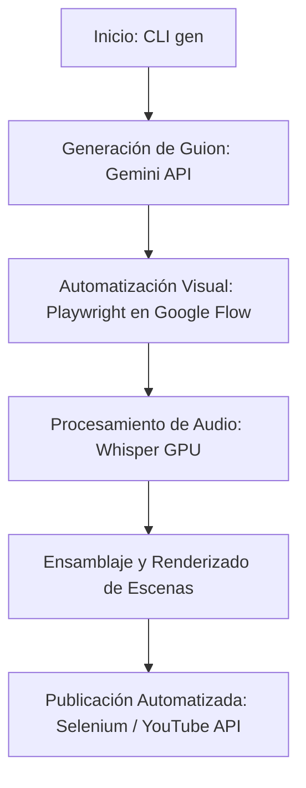

# AI Content Automation Engine

Pipeline de automatización asistido por IA para la generación de guiones, creación de imágenes en Google Flow, renderizado de escenas y publicación automatizada en YouTube.

> **Demostración de rendimiento:** Este pipeline fue utilizado para generar más de 190 videos automatizados en el canal [Hackea Tu Riqueza](https://www.youtube.com/@Hackea_Tu_Riqueza), reduciendo el costo estimado de producción por video de 2.50 USD a menos de 0.50 USD.

## Qué resuelve

Automatiza de principio a fin la cadena de producción de contenido audiovisual. Genera estructuras narrativas mediante la API de Gemini, automatiza la creación de assets visuales en Google Flow con Playwright, procesa audio y subtítulos con Whisper en GPU, y automatiza la programación de publicaciones en canales de YouTube.

## Cómo funciona



1. **Generación narrativa:** Solicita a la API de Gemini los textos, estructura por escenas y prompts visuales.
2. **Generación visual:** Controla un navegador headless vía Playwright para generar imágenes en Google Flow.
3. **Transcripción y Audio:** Procesa la síntesis de voz y transcripción temporal mediante Whisper ejecutado en GPU.
4. **Publicación:** Carga los contenidos finales y los programa en los canales de YouTube configurados.

## Guía de uso

### Requisitos
- Python 3.11+
- Poetry (gestor de dependencias)
- GPU NVIDIA (requerido para aceleración de Whisper en local)
- Google Chrome instalado

### Instalación
```bash
git clone https://github.com/JeremyAyza/ai-video-automation-pipeline.git
cd ai-video-automation-pipeline
poetry install
```

### Configuración
Copia el archivo de ejemplo y configura tu clave de API:
```bash
cp .env.sample .env
```

### Ejecución
```bash
poetry run gen --help
```

## Decisiones técnicas

- **Poetry:** Utilizado para garantizar un entorno determinista de dependencias de Python (pydantic, selenium, google-genai).
- **Playwright para Flow:** Permite automatizar la creación de assets en interfaces web modernas sin depender de APIs privadas.
- **Whisper Local (GPU):** Reduce los costos de transcripción al ejecutar el modelo de procesamiento de voz directamente en la GPU local.
- **Arquitectura Modular por Flujos:** Organizado en carpetas independientes (`flows/`) para aislar la lógica de generación de imágenes, audio y publicación.

## Estado y límites conocidos

- **Estado:** Proyecto funcional probado en entorno de producción local con Windows y GPU NVIDIA.
- **Límites:** La ejecución completa requiere entorno Windows con tarjeta gráfica NVIDIA (debido a dependencias de Winotify y aceleración CUDA de Whisper).
- **Pruebas:** Verificación ejecutada mediante inspección estática del código.

## Créditos y licencia

- **Autor de las extensiones:** Jeremy Ayza ([JeremyAyza](https://github.com/JeremyAyza))
- **Proyecto Base:** Basado en el proyecto open-source *AI Content Automation Engine* (abril de 2026).
- **Licencia:** MIT License
